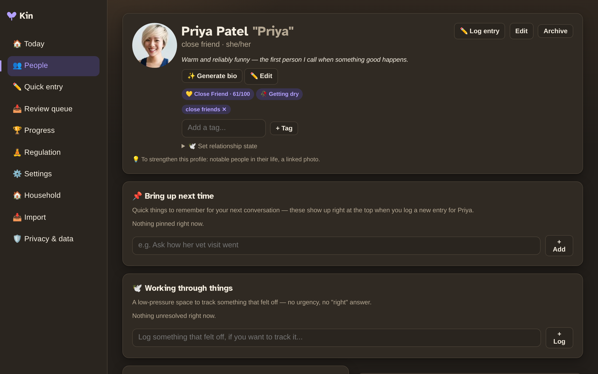
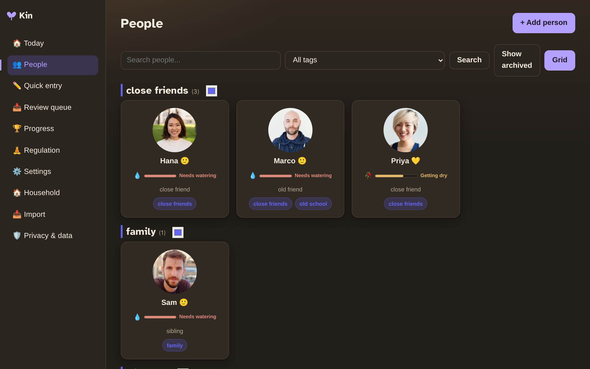
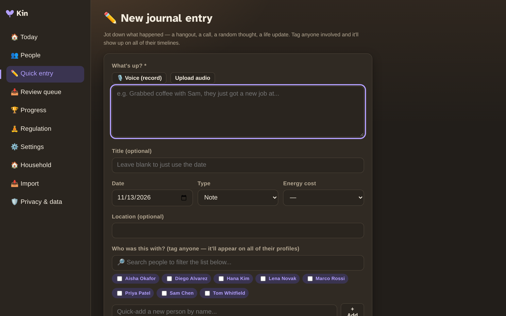

# Core concepts

Kin is built around a few simple ideas. Get these, and the rest is obvious.

## People

A **person** is the heart of Kin — a profile for someone in your life. It holds their birthday, how you met, contact info, occupation, hobbies, and free-form notes. You can also attach:

- **Tags** (called *circles*) — group people your own way: `family`, `work`, `close friends`.
- **Notable dates** — anniversaries, their kids' birthdays, anything recurring.
- **A scratchpad** — "bring this up next time" reminders.
- **Gift ideas** — so you never scramble again.

{ width="700" }

{ width="700" }

## The journal

The **[journal](glossary.md#journal)** is a quick-capture log. One box: who you saw, what happened, when. Optionally tag the people, attach photos, add a location, and rate the energy it cost (low/medium/high) so you can plan your social bandwidth over time.

{ width="700" }

Entries roll up onto each person's timeline automatically, so a person's profile becomes a living history of your friendship.

## Gentle nudges (not guilt)

Kin reminds you to reach out — but carefully:

- **Check-in cadence** — set how often you'd like to touch base with someone (e.g. every 60 days). Kin shows a gentle "needs watering" meter as that date approaches, framed like a houseplant, never an alarm.
- **"Time to reach out"** — a calm list of people who are due, with an easy snooze.
- **Grace mode** — pause *all* nudges for a week, no reason needed. Rest is a feature here.

## Relationship states

You can mark a relationship as *drifted* or *wants space*, or Kin can suggest it. These states soften or suppress the nudges for that person — so Kin respects when a relationship needs room.

## The regulation toolkit

A quiet corner for when thoughts are looping: breathing exercises, grounding, a "facts vs. the story anxiety is telling me" reframe, and a few gentle games. It's always one click away, no AI, no pressure. Read more in [Features](features.md#regulation-toolkit).
