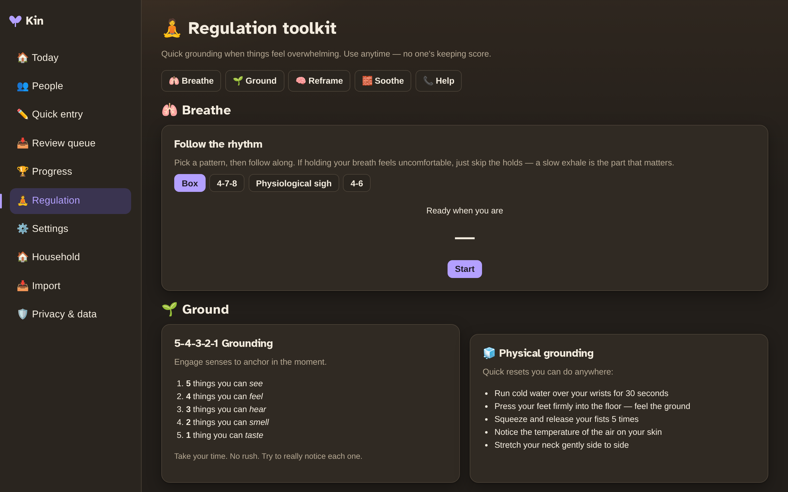

# Features

Everything Kin does, grouped by what it's for. Every one of these is optional — Kin is genuinely useful with nothing configured at all.

## Regulation toolkit

A sidebar link that's always there for you: **breathe**, **ground**, **reframe**, and **soothe** — no AI, no score, no pressure.

- **Breathe** — follow-along patterns (box breathing, 4-7-8, physiological sigh).
- **Ground** — a 5-4-3-2-1 senses exercise and quick physical resets.
- **Reframe** — "facts vs. the RSD story", the STOP technique, and naming the feeling.
- **Soothe** — a handful of gentle games to occupy your hands when thoughts are looping: Soft Fall (falling blocks), 2048, Memory, Minesweeper, and **Dot Muncher** (a cozy Pac-Man-style maze chase).

{ width="700" }

## Gamification (celebrating rest too)

A quiet XP system with 45+ achievements — but it's not about productivity. You earn XP for logging entries and keeping up, **and** for resting: snoozing a check-in, entering grace mode, letting a conflict go. Achievements unlock silently; you only get a toast for a level-up or a new badge.

## AI assistant *(optional, bring-your-own-key)*

Kin works with OpenAI or any OpenAI-compatible endpoint (including a local Ollama server). With a key configured, it can:

- Write **birthday message drafts** and suggest **gift ideas** (always for you to review, never sent automatically).
- Generate **profile summaries** and **bio blurbs**.
- Offer **conversation starters** and **quick-reply scripts** — "what do I even say?".
- Run a caring **support chat** for working through a conflict, tuned to your relationship.

## Voice *(optional)*

- **Voice notes** — record or upload audio; Kin transcribes it (Whisper) into journal entries and the support chat.
- **Voice replies** — the support chat can reply with a spoken voice (local Piper or OpenAI TTS), with the transcript always available.

## Immich & hangout detection *(optional)*

Connect an [Immich](https://immich.app) photo library and Kin can:

- Link a **face** to each person for profile photos.
- Show **"On this day"** memories.
- Detect when you **hung out** — a linked face in a recent photo surfaces a "looks like you hung out!" card that credits your check-in and offers a one-click journal entry.

## Calendar sync

Subscribe your birthdays and notable dates from any calendar app (Google, Apple, Outlook) via a private, per-person feed URL. Set reminders days ahead so cards and gifts don't sneak up on you.

## Kin Wrapped

Around mid-December, Kin quietly puts together a warm, private **year-in-review** — who you were closest to, your standout moments, and the ways you showed up. Entirely positive (conflicts never appear), and shareable if you choose.
