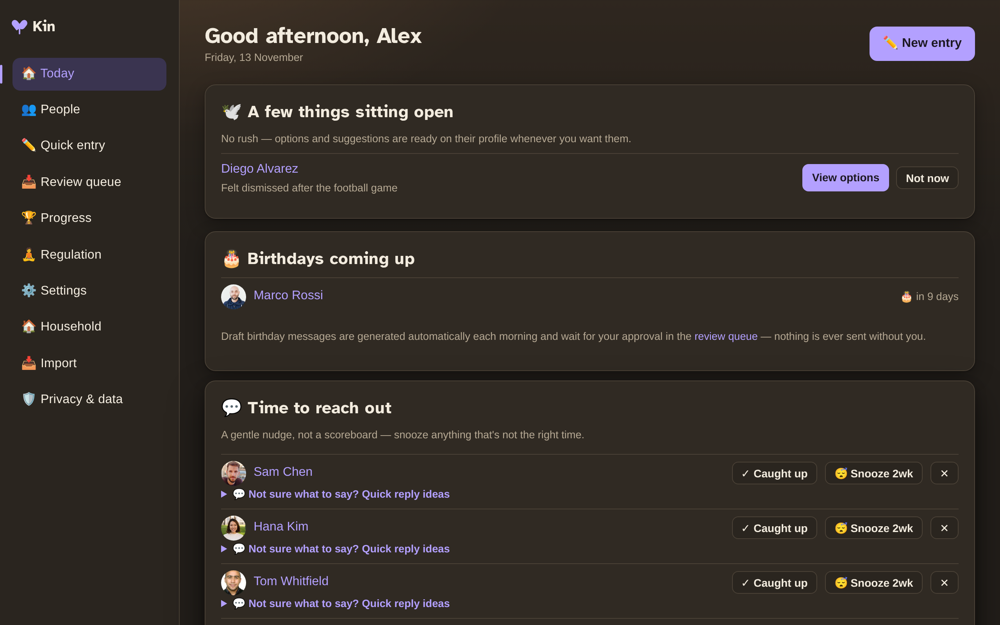

# Kin

**Kin is a self-hosted personal relationship manager** — a private, warm little home for the people in your life.

It exists for one job: to make keeping in touch feel *lighter, not heavier*. Kin remembers the small things (birthdays, how you met, what to bring up next time), gently nudges you to reach out without guilt, and helps you feel prepared — not anxious — before you see someone.

Kin is built by and for neurodivergent brains: it's calm, low-stimulation, and never punishes you for rest. Your data stays on **your own hardware**, in a single [Docker](glossary.md#docker) container with a local [SQLite](glossary.md#sqlite) database. No cloud, no accounts on someone else's server.

## Who it's for

- Anyone who cares about their relationships but finds "staying in touch" hard to keep up with.
- People who want a private, self-hosted alternative to a CRM — one that speaks *your* language, not a sales team's.
- Couples or groups who want to share one Kin (see [Multiple people](multi-user.md)).

## What it does, in a nutshell

- **People** — rich profiles with birthdays, how-you-met, contact info, tags, and notes.
- **[Journal](glossary.md#journal)** — quick-capture logging of who you saw and what happened.
- **Gentle nudges** — a "time to reach out" list and a "needs watering" cadence meter, framed as care, never guilt.
- **AI assistant** *(optional)* — drafts birthday messages, suggests gifts, and helps with what to ask.
- **Voice** *(optional)* — transcribe voice notes and get spoken replies.
- **[Immich](glossary.md#immich) integration** *(optional)* — faces, photos, and "on this day" memories.
- **Regulation toolkit** — breathing, grounding, and a few gentle games for when thoughts are looping.

## The two-minute tour

<figure markdown>
  { width="700" }
  <figcaption>The Today dashboard — everything you need at a glance.</figcaption>
</figure>

New to self-hosting? Start with the [Quick start](quickstart.md) — you'll be running in about five minutes. Already comfortable with Docker? The same page has the one-line version.
