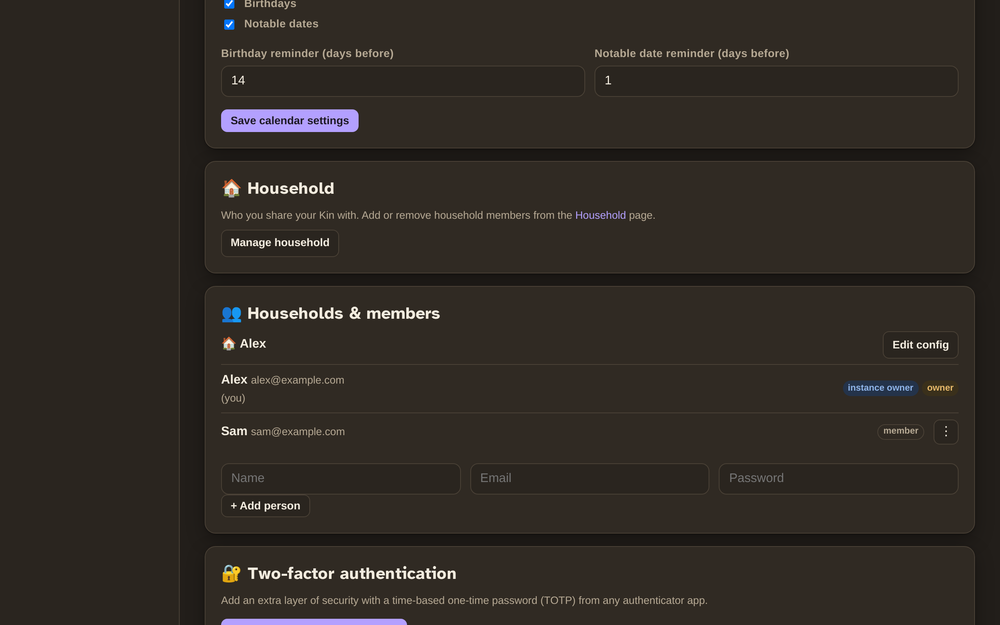
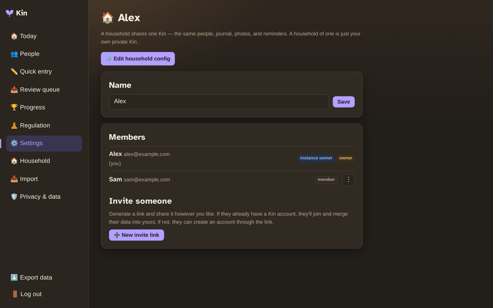

# Multiple people

One Kin install can host several people — each in their own fully private world, or sharing one.

## Individual accounts

By default, every account is **private**: their own people, journal, tags, reminders, and progress, invisible to everyone else. The first account (from the setup wizard) is the **instance owner** and can add more people from **Settings → Households & members**.

{ width="700" }

## Households

Two people can opt to **share one Kin** — the same people, journal, photos, and reminders. This is the "couple or family" setup.

{ width="700" }

To share, open the **Household** page and generate an **invite link**. The link is single-use and expires after 7 days, and works two ways:

- **They already have a Kin account?** Opening the link merges their people and journal into yours.
- **They don't?** The link lets them register a new account straight into your household.

A household of one is just an individual account — nothing changes if you never share.

## Roles

Three simple levels of control:

| Role | What they can do |
|---|---|
| **Instance owner** | Everything — add/remove anyone, manage any household's config, promote other owners, toggle the config lock. |
| **Household owner** | Manage their own household: invite/remove members, promote co-owners, edit the household's Immich/AI/voice config. |
| **Member** | Use the shared data and their personal preferences. |

A household can have multiple owners, and an instance can have multiple instance owners.

## The "hide config" toggle

If someone you host is non-technical (or prone to tinkering), an owner can **hide their config** — their Immich/AI/voice settings disappear, and the owner manages them instead from **Settings → Households & members → Edit config**. Their personal preferences stay their own.

## Where config lives

Immich, AI, and Whisper are **per household** — each household brings its own photo library and AI keys. The TTS voice engine, push keys, and scheduler are **instance-wide** (instance owner only).
